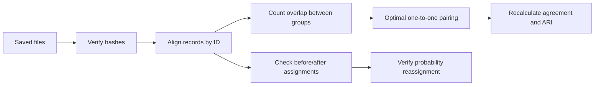

# Reproducibility Audit: Verification Code

Selected working Python code from a completed clustering reproducibility audit.
This repository shows **how the saved results were checked**: file integrity,
record alignment, optimal cluster matching, agreement metrics and reassignment checks.

The six functions in `verification_code.py` are extracted unchanged from the working
audit helper. `code_provenance.json` records their source line ranges and hashes.
`run_verification.py` is a public command-line wrapper added for this repository.
The full experimental pipeline is not included.

## Verified results

The extracted code was rerun locally on the original, privately held evidence:

| Check | Recorded result |
|---|---:|
| Completed runs independently checked | 29 |
| Runs from the additional experiment round | 19 |
| Verification failures | 0 |
| Saved agreement counts, percentages and ARI | Checks passed |
| Probability-based outlier reassignment | Checks passed |
| Recorded source-file hashes | Checks passed |
| New model fits during this verification | 0 |

These are **audit execution results**, not scientific findings or evidence that every
possible error has been eliminated. The aggregate receipt is in
`verification_results.json`. Its underlying data remain private, so an outside reader
cannot independently reproduce those recorded counts from this repository alone.

## What each function does

| Function | Purpose |
|---|---|
| `find_file` | Locate an evidence artifact in the saved directory structure |
| `source_checks` | Compare source-file SHA-256 hashes with the saved manifest |
| `choose2` | Count record pairs for the ARI calculation |
| `compare` | Align a specified ID cohort, find the best one-to-one cluster pairing and calculate agreement and ARI |
| `assignments` | Load a run's saved assignments by stable ID |
| `verify_runs` | Recalculate metrics and check saved labels, probabilities and counts |



## Why these checks matter

Cluster numbers are arbitrary. Group 2 in one run might be group 9 in another.
`linear_sum_assignment` finds the pairing that maximizes the total number of shared
members. IDs, rather than row positions, connect the two outputs.

Agreement measures overlap between two groupings, **not prediction accuracy**. ARI
compares whether record pairs remain together or apart, adjusting for chance.
A small group joining a larger one can reduce one-to-one agreement even when all its
members stay together. These metrics alone do not establish topic meaning or quality.

The original comparison treats all supplied topic labels as groups. Do not compare
different outlier-reassignment stages without documenting that choice. The verification
code expects post-reassignment outputs to contain no `-1` labels.

## Run with authorized local evidence

Python 3.10 or newer:

```sh
python -m venv .venv
source .venv/bin/activate
pip install -r requirements.txt
python run_verification.py private_inputs/evidence private_inputs/results.csv private_inputs/reference.csv private_inputs/comparison_ids.csv
```

No dataset is bundled. The reference CSV needs `ID_noNA_Dup` and `Topic` columns;
the comparison-ID CSV needs `ID_noNA_Dup`. The results table must use the saved
run schema expected in `verify_runs`, including assignment/probability paths,
reported metrics, counts and run status. `manifest.json` contains a `files` mapping
from filenames to SHA-256 hashes. Outputs and probability arrays must be supplied
from the same run and analysis stage. This is an extracted audit workflow, not a
general-purpose training package.

## Scope and limitations

- No participant records, narratives, vectors, research assignments or unpublished scientific findings are included.
- No third-party model implementation or original lab notebook is republished.
- No replacement data, invented measurements or demonstration results are included.
- These functions use assertions: run Python normally, without `-O`, so checks execute.
- The workflow assumes integer topic labels and unique IDs in the source reference.
- Hash equality verifies file identity, not the correctness of the original analysis.
- Verification of saved outputs is separate from fitting a model or reproducing a historical software environment.

The project demonstrates statistical verification and evidence tracking. A complete
model rerun requires separately authorized inputs, model code and its environment.
